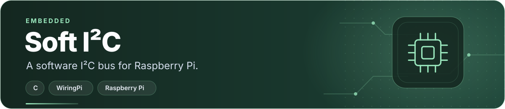

# 

A C library that implements I²C using WiringPi GPIO. It provides bit and byte operations, bus recovery, and device scanning.

[](https://github.com/svazqz/soft_i2c/actions/workflows/ci.yml)

[Quick start](#quick-start) · [Validation](#validation) · [Project layout](#project-layout)

## Quick start

Install the WiringPi development headers on your target and run

```sh
make
```

Link `build/libsoft_i2c.a` with `-lwiringPi`. Call `setupI2C()` before using the default bus. It uses WiringPi pin 9 for SCL and pin 8 for SDA. Serialize access when sharing a bus.

## Validation

```sh
make test
```

The suite simulates GPIO and checks byte transfers, address scanning, and recovery from a stuck line.

## Project layout

| Path | Purpose |
| --- | --- |
| [`include/soft_i2c.h`](include/soft_i2c.h) | Public interface and status codes |
| [`src/soft_i2c.c`](src/soft_i2c.c) | Bus and device operations |
| [`tests/`](tests/) | Simulated GPIO tests |

## Project notes

Call `i2c_status()` after a bus operation. Free the container returned by `i2c_search()` after reading the results.
